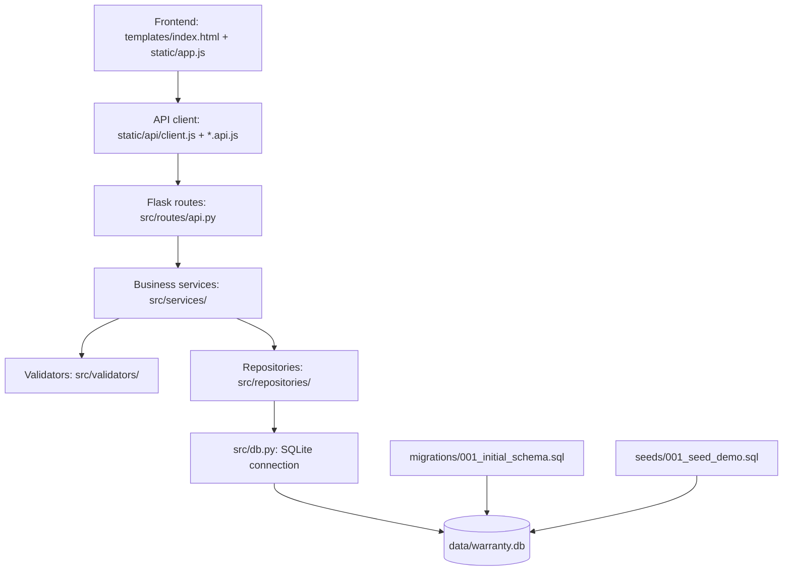

# Kiến trúc thực tế đã hiện thực — BT2

- **Presentation:** `templates/index.html`, `static/app.js`, `static/style.css`.
- **API client frontend:** `static/api/client.js`, `static/api/customers.api.js`, `static/api/tickets.api.js`, `static/api/catalog.api.js`.
- **Routes/controller HTTP:** `src/routes/api.py`; chỉ chuyển đổi HTTP request/response và ánh xạ lỗi nghiệp vụ.
- **Business rules:** `src/services/customer_service.py`, `src/services/ticket_service.py`, `src/services/catalog_service.py`.
- **Validation:** `src/validators/customer_validator.py`, `src/validators/ticket_validator.py`.
- **Persistence:** `src/repositories/`; kết nối và khởi tạo schema/seed nằm trong `src/db.py`.
- **Database:** SQLite; schema được dựng bằng migration và dữ liệu mẫu được nạp bằng seed idempotent (`INSERT OR IGNORE`).

Các quy tắc nghiệp vụ cốt lõi gồm: số điện thoại hợp lệ và duy nhất; thiết bị phải thuộc khách hàng đã chọn; thiết bị phải còn hạn bảo hành; mỗi thiết bị chỉ có một phiếu đang mở; mô tả sự cố tối thiểu 10 ký tự; mức ưu tiên chỉ nhận `CAO`, `TRUNG_BINH`, `THAP`.
